

<!-- ═══════════════════════════════════════════════════════════════════
     HERO SECTION
     ═══════════════════════════════════════════════════════════════════ -->

  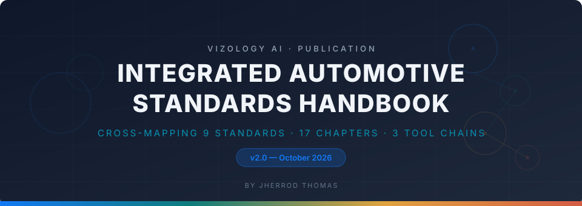

<!-- ═══════════════════════════════════════════════════════════════════
     BADGES
     ═══════════════════════════════════════════════════════════════════ -->

&nbsp;

<!-- ═══════════════════════════════════════════════════════════════════
     STATISTICS STRIP
     ═══════════════════════════════════════════════════════════════════ -->

  

&nbsp;

<!-- ═══════════════════════════════════════════════════════════════════
     TABLE OF CONTENTS
     ═══════════════════════════════════════════════════════════════════ -->

<strong>📑 Table of Contents</strong>

- [Why This Exists](#why-this-exists)
- [Standards Coverage](#standards-coverage)
- [What's Inside](#whats-inside)
- [Integrity Level Cross-Map](#integrity-level-cross-map)
- [Quick Start by Role](#quick-start-by-role)
- [Featured Diagrams](#featured-diagrams)
- [Roadmap](#roadmap)
- [Contributing](#contributing)
- [Disclaimer](#disclaimer)
- [License & Citation](#license--citation)

---

## Why This Exists

Automotive E/E teams typically implement safety, cybersecurity, quality, and process standards in silos — separate teams producing parallel documents and running independent review cycles. The result is redundant work, traceability gaps at domain interfaces, and audit fatigue.

This handbook solves that by organizing requirements **by lifecycle phase** rather than by standard. When you're in the concept phase doing HARA, you see exactly what TARA, SOTIF evaluation, AI safety analysis, and physical AI safety require — in one table, with one set of work products.

> **v2 expands from 6 to 9 standards**, adding IEC 61508, ISO 13849-1, and ISO 10218 for Physical AI and industrial safety coverage.

(<a href="#readme-top">back to top</a>)

---

## Standards Coverage

  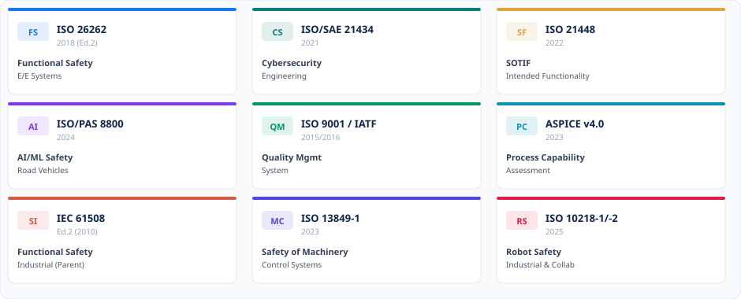

(<a href="#readme-top">back to top</a>)

---

## What's Inside

  

<strong>Expand for chapter details</strong>

### Part I — Foundation & Framework (Ch 1–3)
How to navigate the handbook, nine standards at a glance (structural overview, key concepts, regulatory context for each), and the integration framework with unified V-model.

### Part II — Clause-Level Cross-Mapping (Ch 4–10)
The heart of the handbook. Seven chapters covering every lifecycle phase from organizational setup through decommissioning. Each chapter includes standard-by-standard clause requirements, "Rosetta Stone" cross-mapping tables (9 columns), commonality analysis, gap analysis, integrated activity checklists, and a worked AEB mini-example.

### Part III — End-to-End Worked Examples (Ch 11–12)
**Chapter 11**: ADAS Forward Camera ECU (ASIL B(D), CAL 3) — complete lifecycle from item definition through field monitoring.
**Chapter 12**: AI Pedestrian Detection on NVIDIA Orin (ASIL C, CAL 4) — full AI/ML lifecycle including dataset requirements, model training, adversarial testing, and assurance case.

### Part IV — Practical Tools (Ch 13–16)
8 integrated work product templates (replacing 30+ siloed documents), audit & assessment readiness guide, tool qualification across standards, and three complete reference tool chains (Vector $2–10M+, Siemens $1.5–8M, Lean/OSS $50K–500K).

### Part V — Physical AI Bridge (Ch 17)
The new v2 chapter bridging automotive functional safety into industrial and collaborative robotics — IEC 61508, ISO 13849-1, and ISO 10218 integration with the six automotive standards.

### Appendices (A–D)
Master cross-reference matrix (80+ activities mapped across all standards), 50+ IEEE-format references, 150+ acronyms & glossary, and the tool chain decision matrix.

(<a href="#readme-top">back to top</a>)

---

## Integrity Level Cross-Map

One of the handbook's most referenced tables — mapping integrity and performance levels across standard families:

  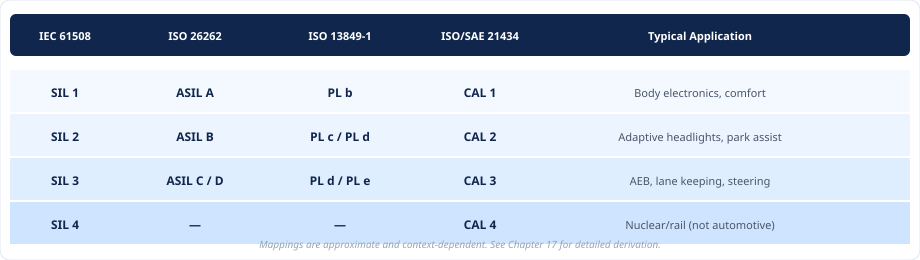

(<a href="#readme-top">back to top</a>)

---

## Quick Start by Role

  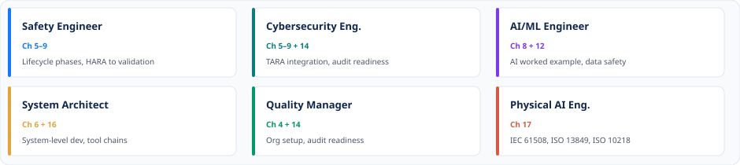

| Role | Start Here | Key Chapters |
|:-----|:-----------|:-------------|
| **Functional Safety Engineer** | Ch 5–9 | Lifecycle phases, HARA → validation |
| **Cybersecurity Engineer** | Ch 5–9 + Ch 14 | TARA integration, audit readiness |
| **Software Developer** | Ch 8 | SW & AI/ML development phase |
| **AI/ML Engineer** | Ch 8 + Ch 12 | AI worked example, data safety |
| **System Architect** | Ch 6 + Ch 16 | System-level dev, tool chains |
| **Quality / Process Manager** | Ch 4 + Ch 14 | Org setup, audit readiness |
| **Physical AI / Robotics Eng.** | Ch 17 | IEC 61508, ISO 13849, ISO 10218 |
| **Auditor / Assessor** | Ch 14 + App A | Audit guide, master cross-ref |

(<a href="#readme-top">back to top</a>)

---

## Featured Diagrams

The `visuals/` directory contains publication-quality diagrams. Each diagram below is available as an SVG in the repository:

  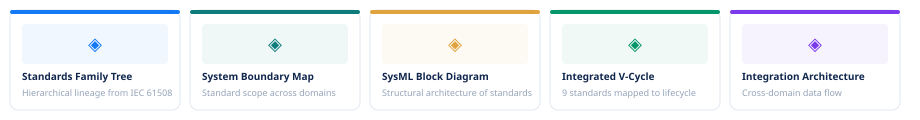

&nbsp;

<strong>Standards Family Tree</strong> — Hierarchical lineage from IEC 61508 through domain derivatives

  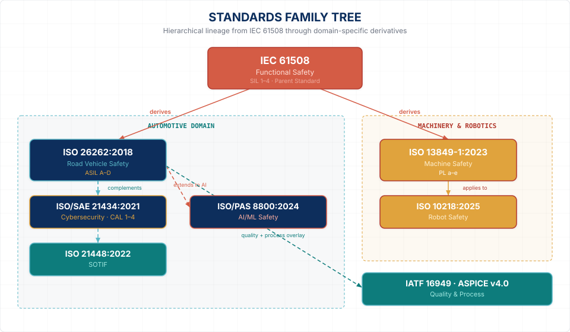

<strong>System Boundary Map</strong> — Standard scope across automotive domains

  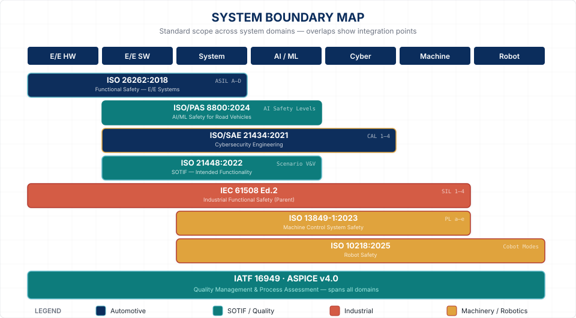

<strong>SysML Block Definition</strong> — Structural architecture of standards as blocks

  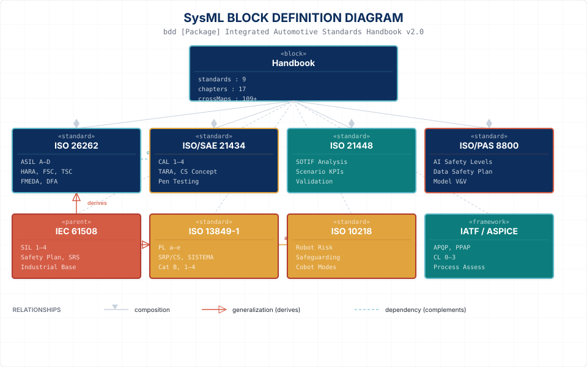

<strong>Integrated V-Cycle</strong> — 9 standards mapped to lifecycle phases

  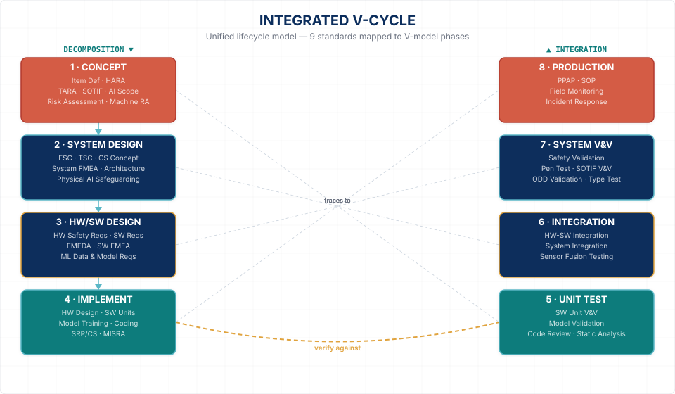

<strong>Integration Architecture</strong> — Cross-domain data flow

  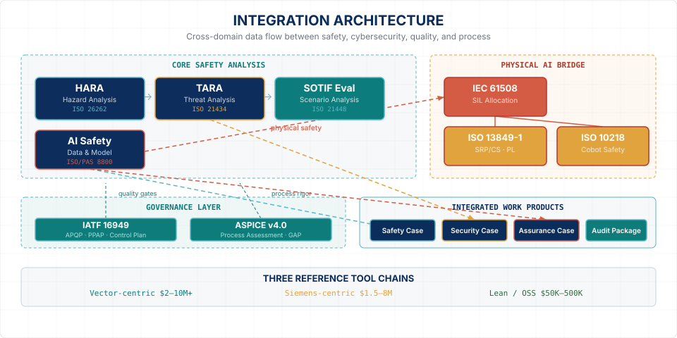

(<a href="#readme-top">back to top</a>)

---

## Roadmap

  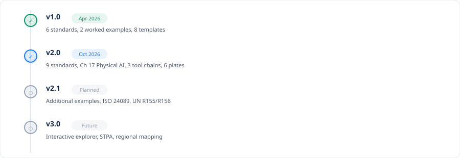

<strong>Expand roadmap details</strong>

### v1.0 (April 2026) — Initial Release
- Complete clause-level cross-mapping for 6 standards
- Two end-to-end worked examples (ADAS camera ECU + AI pedestrian detection)
- 8 consolidated work product templates

### v2.0 (October 2026) — Current Release
- Expanded to **9 standards** with IEC 61508, ISO 13849-1, ISO 10218
- **Chapter 17**: Physical AI bridge (machinery & collaborative robotics)
- **3 reference tool chains** with 200+ tools cataloged
- **6 publication-quality infographic plates**
- Interactive workbook prototype

### v2.1 (Planned)
- Downloadable filled-in artifact templates
- Additional worked examples (powertrain, body electronics, chassis)
- ISO 24089:2023 (Software Update Engineering) overlay
- UN R155/R156 regulatory mapping

### v3.0 (Future)
- Interactive web-based cross-reference explorer
- STPA integration (SAE J3187)
- Regional regulatory mapping (China GB/T, Japan JASO, Korea KS)
- Community contributions and errata

(<a href="#readme-top">back to top</a>)

---

## Contributing

Contributions are welcome. If you spot an incorrect clause reference, have a better worked example, or want to expand coverage to additional standards, please open an issue or submit a pull request.

**Areas where help is especially welcome:** clause reference verification against published standards, additional worked examples (powertrain, body electronics, chassis), regional regulatory mapping (China GB/T, Japan JASO, Korea KS), tool-specific qualification guidance, and Physical AI / collaborative robotics case studies.

(<a href="#readme-top">back to top</a>)

---

## Disclaimer

This handbook is a **reference guide** for educational and professional development purposes. It does not reproduce copyrighted standard text. Users must obtain and consult the official published standards from ISO, SAE, IEC, VDA, and AIAG for normative requirements. The authors make no warranty regarding completeness or accuracy — always verify against the published standard of record.

---

## License & Citation

This work is licensed under [CC BY-SA 4.0](https://creativecommons.org/licenses/by-sa/4.0/). You are free to share and adapt the material with attribution.

> Jherrod Thomas, *Integrated Automotive Standards Handbook*, v2.0, ISH-2026-002, Oct. 2026. [Online]. Available: https://github.com/jherrodthomas/integrated-automotive-standards-handbook

---

  

(<a href="#readme-top">back to top</a>)

